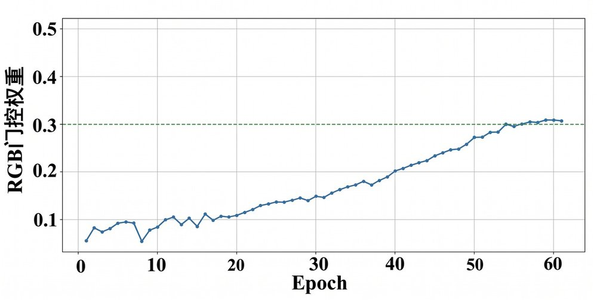
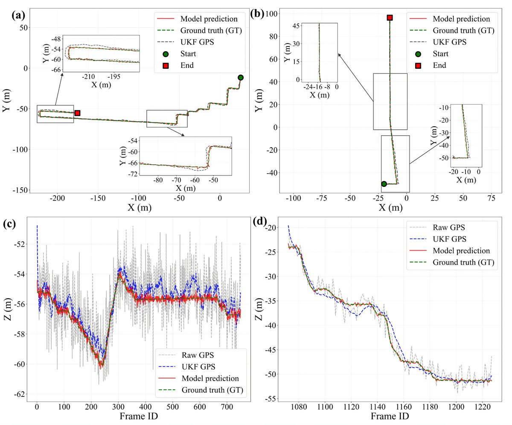

# PGCF-RSU

**P**rogressive **G**ated **C**ross-modal **F**usion for multi-**RSU** visual-wireless localization.

中文名：渐进式门控跨模态融合的多路侧单元视觉-无线协同定位。简称 **PGCF-RSU**。

方法面向复杂城市和地空混合交通：用多视角视觉补全无线信道里缺失的观测，再按路侧几何质量把多个路侧单元融合起来，在 GPS 先验上回归地面车辆和空中出租车的六维位姿。代码对应 Codabench 赛题三 [无线基座模型 WiFo 赋能的多模态信息智能车定位](https://www.codabench.org/competitions/11207/#/participate-tab)。

## 方法


四步和仓库目录一一对应：

```text
多视角 RGB
  → visual/          朝向编码与交叉注意力，补全缺失帧，得到 1024 维视觉特征
CSI + 视觉特征
  → finetune/        渐进门控注入 WiFo，导出每个路侧单元的 512 维特征
GPS + 12 维几何量
  → localize/        按观测质量融合多路侧单元，预测位姿修正
```



门控从很小的初值慢慢打开，避免视觉特征一开始盖过已经预训练好的信道表征。



## 论文中的定位误差

动态加权的 CSI+RGB 在四组评测上的平均绝对误差为 **0.1846、0.2057、0.3080、0.1581 m**。相对原始 GPS 分别下降 **86.69%、85.06%、84.69%、88.49%**，相对 KF/UKF 滤波先验分别下降 **75.01%、72.09%、78.48%、78.69%**。数字来自投稿《自动化学报》的文稿，不是本仓库重新跑出来的日志。

## 环境

Python 3.9，PyTorch 2.x。

```bash
pip install -r requirements.txt
git clone https://github.com/facebookresearch/dinov2 third_party/dinov2
```

```bash
export DATA_ROOT=/path/to/competition_data
export DINOV2_ROOT=/path/to/dinov2
export DINOV2_WEIGHTS=/path/to/dinov2_vitl14_reg4_pretrain.pth
export WIFO_WEIGHTS=/path/to/WiFo-RGB.pkl
```

`DATA_ROOT` 下需要 `train/`、`test/`、`images/train/`、`images/test/`，以及 RGB 覆盖率文本。赛题数据、WiFo 权重和 DINOv2 权重都不在本仓库里。

## 运行

视觉特征，在 `visual/`：

```bash
python build_masks.py
python train_completion.py
python infer_completion.py
python train_fusion.py
python infer_fusion.py
python pack_features.py --fused-dir outputs/fused_features --out-dir ../finetune/fusion-train-RGB
```

微调与导出，在 `finetune/`：

```bash
python masks/build.py
python masks_test/build.py
python train.py
python infer.py
```

定位，在 `localize/`：

```bash
python train.py
python infer.py
```

`infer.py` 读取 `logs/checkpoints` 中的权重，轨迹写到 `localize/predictions/Scene_1`、`Scene_2`、`Scene_3`。地面车辆用二维卡尔曼，空中目标用三维 UKF，开关在 `config_test.py`。

## 目录

| 目录 | 作用 |
| --- | --- |
| `visual/` | 多视角视觉特征、缺帧补全、三视角融合 |
| `finetune/` | WiFo 渐进门控微调，以及按车辆导出特征 |
| `localize/` | 几何质量融合和 GPS 引导的位姿回归 |
| `docs/figures/` | 论文中的流程、门控曲线和轨迹图 |

每个程序文件开头只有一句用途说明。

## 致谢

方法与上表结果来自《自动化学报》投稿《基于渐进式门控跨模态融合的多路侧单元视觉-无线协同定位方法》。作者为张项钧、张栋、许亮、崔文婷、杜少毅、薛万利、左博旭（天津理工大学，西安交通大学人工智能与机器人研究所）。

- 感谢中国智能车未来挑战赛组委会和赛题三提供数据与 Codabench 评测。
- 信道编码器使用 WiFo：Boxun Liu, Shijian Gao, Xuanyu Liu, Xiang Cheng, Liuqing Yang, *WiFo: Wireless Foundation Model for Channel Prediction*。
- 视觉编码器使用 Meta [DINOv2](https://github.com/facebookresearch/dinov2)，Apache-2.0。

## 许可

本仓库代码使用 MIT License，见 `LICENSE`。WiFo 权重和 DINOv2 遵循各自的发布条款。
