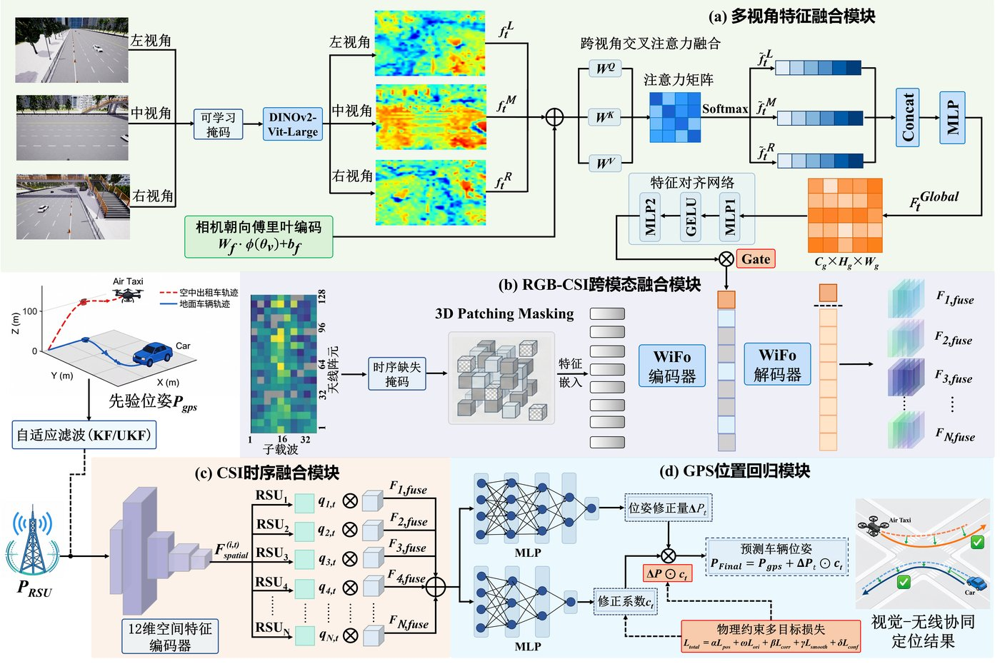

# PGCF-RSU

**P**rogressive **G**ated **C**ross-modal **F**usion for multi-**RSU** visual-wireless localization.

中文名：渐进式门控跨模态融合的多路侧单元视觉-无线协同定位。简称 **PGCF-RSU**。

方法面向复杂城市和地空混合交通：用多视角视觉补全无线信道里缺失的观测，再按路侧几何质量把多个路侧单元融合起来，在 GPS 先验上回归地面车辆和空中出租车的六维位姿。代码对应 [2025中国智能车未来挑战赛](https://ivfc.caa.org.cn/info/1017/1121.htm) 离线测试算法大赛赛题三 [无线基座模型 WiFo 赋能的多模态信息智能车定位](https://www.codabench.org/competitions/11207/#/participate-tab)。

## 方法



```text
多视角 RGB
  → visual/          朝向编码与交叉注意力，补全缺失帧，得到 1024 维视觉特征
CSI + 视觉特征
  → finetune/        渐进门控注入 WiFo，导出每个路侧单元的 512 维特征
GPS + 12 维几何量
  → localize/        按观测质量融合多路侧单元，预测位姿修正
```

门控从很小的初值慢慢打开，避免视觉特征一开始盖过已经预训练好的信道表征。

四组评测的平均绝对误差为 **0.1846、0.2057、0.3080、0.1581 m**。相对原始 GPS 分别下降 **86.69%、85.06%、84.69%、88.49%**，相对 KF/UKF 滤波先验分别下降 **75.01%、72.09%、78.48%、78.69%**。

## 环境

Python 3.9，PyTorch 2.x。

```bash
pip install -r requirements.txt
git clone https://github.com/facebookresearch/dinov2 third_party/dinov2
```

```bash
export DATA_ROOT=/path/to/competition_data
export DINOV2_ROOT=/path/to/dinov2
export DINOV2_WEIGHTS=/path/to/dinov2_vitl14_reg4_pretrain.pth
export WIFO_WEIGHTS=/path/to/WiFo-RGB.pkl
```

`DATA_ROOT` 下需要 `train/`、`test/`、`images/train/`、`images/test/`，以及 RGB 覆盖率文本。赛题数据、WiFo 权重和 DINOv2 权重都不在本仓库里。

阶段之间的文件名需要保持不变：`visual/pack_features.py` 写出 `{Scene}_{RSF}_features.npz`，键名是 `fused`；`finetune` 导出 `{vehicle}_RSF{n}_wifo_features.npy`，定位阶段按这个名字读取。

## 运行

视觉特征，在 `visual/`：

```bash
python build_masks.py
python train_completion.py
python infer_completion.py
python train_fusion.py
python infer_fusion.py
python pack_features.py --fused-dir outputs/fused_features --out-dir ../finetune/fusion-train-RGB
```

微调与导出，在 `finetune/`：

```bash
python masks/build.py
python masks_test/build.py
python train.py
python infer.py
```

定位，在 `localize/`：

```bash
python train.py
python infer.py
```

`localize/infer.py` 读取定位权重，轨迹写到 `localize/predictions/Scene_1`、`Scene_2`、`Scene_3`。地面车辆用二维卡尔曼，空中目标用三维 UKF，开关在 `localize/config_test.py`。

## 代码结构

三个目录对应三条训练和推理链路。每个程序文件开头只有一句用途说明。训练只打印损失并保存权重，不写曲线，也不保存可视化记录。

### visual：多视角视觉特征

| 文件 | 作用 |
| --- | --- |
| `build_masks.py` | 根据覆盖率文本生成 RGB 缺失帧掩码 |
| `config.py` | 补全阶段的数据路径、DINOv2 和 Transformer 配置 |
| `config_infer.py` | 补全推理的图像、掩码和输出路径 |
| `config_fusion.py` | 三视角融合训练和推理的路径与场景 |
| `train_completion.py` | 提取 DINOv2 特征并训练缺失帧补全 |
| `infer_completion.py` | 用补全模型填上缺失帧的视觉特征 |
| `train_fusion.py` | 训练左、中、右三视角融合 |
| `infer_fusion.py` | 把三个视角合成每个路侧单元一条 1024 维序列 |
| `pack_features.py` | 把融合后的 npy 打包成微调阶段读取的 npz |
| `data/sequences.py` | 按时间顺序读取 RGB 帧 |
| `data/infer_set.py` | 按场景和路侧单元组织补全推理样本 |
| `data/fusion_set.py` | 为三视角融合提供成对特征样本 |
| `data/__init__.py` | 导出视觉阶段的数据集接口 |
| `models/backbone.py` | 加载 DINOv2，把图像序列编成 1024 维特征 |
| `models/completion.py` | 用 Transformer 根据相邻帧补全缺失特征 |
| `models/fusion.py` | 按相机朝向做交叉注意力，融合三个视角 |
| `models/__init__.py` | 导出骨干、补全网络和融合网络 |
| `utils/common.py` | 随机种子、视角角度、损失和 checkpoint 读写 |
| `utils/__init__.py` | 导出上述公共函数 |

### finetune：WiFo 渐进门控

| 文件 | 作用 |
| --- | --- |
| `config.py` | 微调的数据、模型和优化配置 |
| `config_infer.py` | 特征导出使用的数据、掩码、权重和输出路径 |
| `config_test.py` | 测试集导出时的路径和场景 |
| `train.py` | 冻结 WiFo 编码器，训练视觉投影和渐进门控 |
| `resume.py` | 从已有 checkpoint 继续微调 |
| `infer.py` | 按车辆和路侧单元导出 512 维特征 |
| `infer_parallel.py` | 多 GPU 版本的特征导出 |
| `masks/build.py` | 根据训练集 CSI 是否有效，生成微调用掩码 |
| `masks_test/build.py` | 根据测试集 CSI 生成掩码，并把后半段标为待预测 |
| `data/windows.py` | 把 CSI 和视觉特征切成滑窗，供训练 |
| `data/windows_test.py` | 测试集上的滑窗数据集 |
| `data/full_sequence.py` | 按完整序列读取 CSI、掩码和视觉特征，供导出 |
| `data/csi.py` | 读取测试集 CSI mat |
| `data/mask_io.py` | 读取测试集 CSI 有效帧掩码 |
| `data/rgb_io.py` | 读取测试集视觉融合 npz，并补齐到模型长度 |
| `data/gps.py` | 从 GPS 文本读取车辆出现的帧范围 |
| `data/__init__.py` | 导出滑窗数据集和测试集读取接口 |
| `models/network.py` | 渐进门控：把 1024 维视觉特征注入 WiFo 解码器 |
| `models/pretrained.py` | 把 WiFo-RGB 预训练权重载入编码器 |
| `models/embed.py` | 把 CSI 切成三维 patch 并嵌入 |
| `models/positional.py` | CSI patch 的三维正余弦位置编码 |
| `models/layers.py` | WiFo 使用的 Transformer 块 |
| `models/masking.py` | 训练时的随机掩码，以及按有效帧约束的掩码 |
| `models/losses.py` | 只在有效 patch 上计算 CSI 重建损失 |
| `models/__init__.py` | 导出微调网络、预训练加载和重建损失 |
| `utils/aggregate.py` | 把 patch 特征聚合成与 GPS 对齐的帧级特征 |
| `utils/__init__.py` | 导出帧级特征聚合函数 |

### localize：多路侧定位

| 文件 | 作用 |
| --- | --- |
| `config.py` | 定位训练的路径、场景和模型配置 |
| `config_test.py` | 测试车辆、滤波开关和轨迹输出路径 |
| `train.py` | 训练几何质量融合和 GPS 引导的六维位姿修正 |
| `infer.py` | 加载定位权重，输出三个场景的车辆轨迹 |
| `data/train_set.py` | 组装训练用的多路侧特征、GPS、真值和几何量 |
| `data/test_set.py` | 组装测试用的多路侧特征、GPS 和几何量 |
| `data/__init__.py` | 导出定位阶段的数据读取接口 |
| `data/loaders/features.py` | 读取微调阶段导出的 512 维 CSI 特征 |
| `data/loaders/gps.py` | 读取带噪声的 GPS 六维位姿 |
| `data/loaders/ground_truth.py` | 读取车辆位姿真值 |
| `data/loaders/rsu.py` | 读取路侧单元的位置和外参 |
| `data/loaders/__init__.py` | 导出上述读取函数 |
| `models/geometry.py` | 把距离、角度和道路关系编成 12 维几何特征 |
| `models/quality.py` | 估计每个路侧单元的观测质量并加权融合 |
| `models/temporal.py` | 用 Transformer 对融合后的特征做时间建模 |
| `models/regression.py` | 以 GPS 为先验，预测六维修正量和逐维系数 |
| `models/concat.py` | 消融用的拼接投影融合，不作为默认路径 |
| `models/__init__.py` | 导出几何编码、质量融合、时序模型和位姿回归 |
| `utils/constants.py` | 场景、车辆、路侧单元和坐标系常量 |
| `utils/coordinates.py` | 车体高度修正、角度换算和路侧坐标到世界坐标 |
| `utils/antenna.py` | 路侧天线在世界坐标系中的位置 |
| `utils/completeness.py` | 按 CSI 缺失表把无效帧的特征置零 |
| `utils/kalman.py` | 地面车辆使用的二维卡尔曼平滑 |
| `utils/ukf.py` | 空中目标使用的无迹卡尔曼滤波 |
| `utils/adaptive_filter.py` | 按车辆类型选择卡尔曼或无迹卡尔曼 |
| `utils/metrics.py` | 位置误差指标 |
| `utils/__init__.py` | 导出坐标变换、路侧天线位置、损失和指标 |
| `utils/losses/pose.py` | 位置、姿态和修正系数的联合损失 |
| `utils/losses/__init__.py` | 导出六维位姿损失 |

## 致谢

- 感谢中国智能车未来挑战赛组委会和赛题三提供数据与 Codabench 评测。
- 信道编码器使用 WiFo：Boxun Liu, Shijian Gao, Xuanyu Liu, Xiang Cheng, Liuqing Yang, *WiFo: Wireless Foundation Model for Channel Prediction*。
- 视觉编码器使用 Meta [DINOv2](https://github.com/facebookresearch/dinov2)，Apache-2.0。

## 许可

本仓库代码使用 MIT License，见 `LICENSE`。WiFo 权重和 DINOv2 遵循各自的发布条款。
